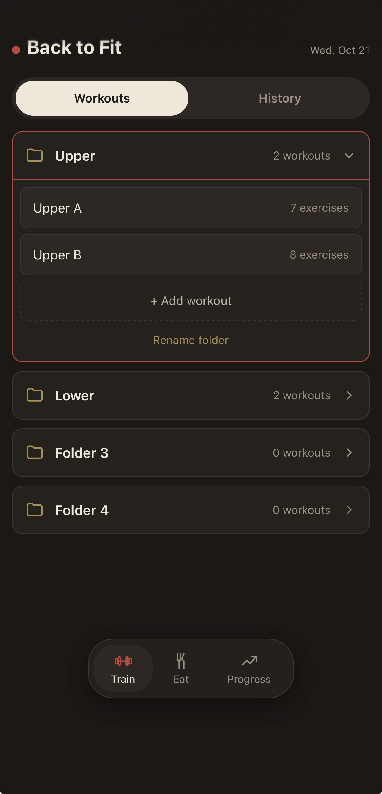
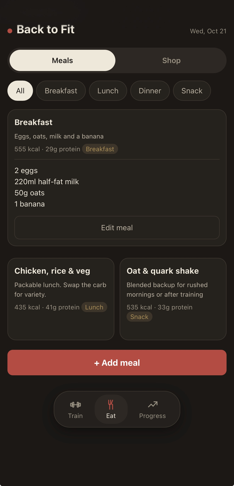
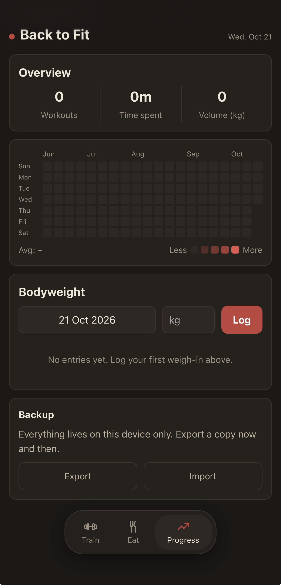

<h1 align="center">Training Plan</h1>

Your workouts, right in your pocket

  
  
  

  

## Screenshots

  
  
  

## Main Features

- **Train tab**
  Add as many workouts as you want. No 3 workout limit, fill those folders UP! You get 4 folders for now, and each one holds as many workouts as you like. Log your sets, track your rest, and the app nudges your weights up as you get stronger.

- **History**
  Every finished workout is saved as a card with the exercises, best sets, time and total weight lifted.

- **Eat tab**
  Cool recipes you found online can now all be in one cozy space. Tag them as breakfast, lunch, dinner or snack. Add your own as well, but don't blame us if they don't taste good.

- **Shop button inside Eat tab**
  Keep all your workout ingredients in one list. Add as many as you want, as long as you can pay for all that. Prices add up for you, in your own currency.

- **Progress tab**
  THE tab with all the info you would need.
  - Log your weight and see how it changes over time.
  - Calendar-shaped widget to show your friends that you are active.
  - Quick summary of all your workouts, time spent at the gym and total weight lifted in a single row.

## Also included

- Works offline, so it opens even with no signal at the gym
- Screen stays awake during a workout
- Rest timer and session timer
- Export and import your data as a backup
- A banner tells you when a new version is available

## Install

It's a web app, so there's nothing to download from a store.

**iPhone / iPad**
1. Open the link above in Safari
2. Tap the Share button
3. Tap **Add to Home Screen**

**Android**
1. Open the link above in Chrome
2. Tap the menu (three dots)
3. Tap **Install app** or **Add to Home screen**

## Your data

Everything is stored on your device only. There are no accounts and no tracking. That also means your data does not sync between devices, and clearing your browser data or removing the app can erase it. Use **Progress → Backup → Export** now and then to keep a copy.
